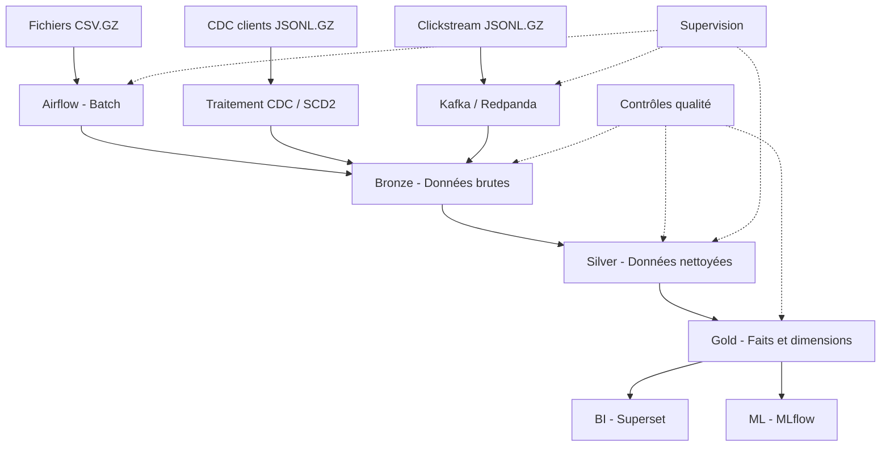

# L1 — Dossier d'architecture NeoRetail

**Projet :** Plateforme Data Engineering omnicanale NeoRetail  
**Version :** 1.0 — Architecture préliminaire  
**Date :** 19 octobre 2026  
**Responsable du projet :** Chef de projet NeoRetail

---

## 1. Contexte et objectifs

### 1.1. Contexte du projet

NeoRetail est un projet de plateforme de données destiné à centraliser et exploiter des informations provenant de plusieurs activités du commerce omnicanal : ventes en ligne, ventes en magasin, catalogue produits, clients, retours logistiques, écritures comptables et événements de navigation.

La diversité des sources et des modes d'alimentation nécessite une architecture capable de gérer les traitements périodiques, les modifications des données clients et les événements de navigation.

Le projet vise à construire une chaîne de traitement reproductible permettant de passer des fichiers sources à des données nettoyées, contrôlées et exploitables pour l'analyse métier et le Machine Learning.

### 1.2. Problématiques identifiées

Les principales problématiques auxquelles NeoRetail doit répondre sont :

- Centraliser les données issues de plusieurs systèmes et canaux de vente.
- Garantir la cohérence des données et limiter les doublons.
- Conserver l'historique des modifications des clients.
- Intégrer les événements de navigation dans une chaîne de traitement streaming.
- Produire des indicateurs fiables sur le chiffre d'affaires, le panier moyen, la conversion et les retours.
- Mettre en place des contrôles qualité, une traçabilité et une supervision des traitements.

### 1.3. Objectifs du projet

Le projet est organisé autour des objectifs suivants :

1. Concevoir une architecture Lakehouse structurée en couches Bronze, Silver et Gold.
2. Mettre en place des pipelines batch avec Airflow.
3. Intégrer les événements de navigation à l'aide de Kafka ou Redpanda.
4. Transformer les données avec dbt en tables de faits et dimensions.
5. Contrôler la qualité et documenter les données.
6. Réaliser un cas d'usage Machine Learning avec suivi des expériences.
7. Construire un tableau de bord décisionnel.
8. Superviser les pipelines, documenter les choix techniques et préparer une démonstration de bout en bout.

### 1.4. Périmètre

Le périmètre couvre l'ingestion, le stockage, la transformation, la qualité, la gouvernance, l'analyse décisionnelle, un cas d'usage ML et la supervision.

Le projet sera développé dans un environnement local conteneurisé avec Docker Compose. Les composants techniques seront validés progressivement afin de garantir leur compatibilité et leur bon fonctionnement.

---

## 2. Sources de données et volumes

### 2.1. Inventaire des sources

Le pack NeoRetail contient les sources suivantes. Les volumes sont ceux indiqués dans le README fourni avec le jeu de données.

| Source | Volume annoncé | Format | Utilisation prévue |
|---|---:|---|---|
| customers | 100 000 lignes | CSV.GZ | Référentiel clients |
| products | 20 000 lignes | CSV.GZ | Référentiel produits |
| stores | 200 lignes | CSV.GZ | Référentiel magasins |
| orders | 500 000 lignes | CSV.GZ | Commandes |
| order_items | 1 000 000 lignes | CSV.GZ | Lignes de commande |
| pos_sales | 500 000 lignes | CSV.GZ | Ventes en point de vente |
| returns | 100 000 lignes | CSV.GZ | Retours |
| gl_entries | 100 000 lignes | CSV.GZ | Écritures comptables |
| clickstream | 1 000 000 événements | JSONL.GZ | Événements de navigation |
| customer_updates | 50 000 événements | JSONL.GZ | Modifications des clients (CDC) |

Le volume total annoncé est de **3 370 200 lignes et événements**.

### 2.2. Fichiers de métadonnées

Le pack contient également :

- `metadata/data_dictionary.csv` : dictionnaire des données fourni.
- `metadata/manifest.csv` : fichier de métadonnées à exploiter pour vérifier les caractéristiques et l'organisation des sources.
- `README.md` : description du pack, volumes et consignes d'exploitation.

Ces fichiers permettront de documenter les sources et de fiabiliser les traitements.

### 2.3. Modes d'alimentation

Trois modes d'alimentation sont prévus :

- **Batch :** ingestion périodique des fichiers CSV.GZ contenant les données de référence, les commandes, les ventes, les retours et les écritures comptables.
- **CDC :** traitement des modifications clients présentes dans `cdc/customer_updates.jsonl.gz`, avec une stratégie d'historisation SCD2.
- **Streaming :** rejeu des événements présents dans `stream/clickstream.jsonl.gz` vers Kafka ou Redpanda, puis conservation en Bronze.

### 2.4. Précautions relatives aux données

Les volumes du README représentent les volumes annoncés pour les jeux de données. Ils devront être vérifiés par les scripts d'inventaire et les contrôles d'ingestion.

Les fichiers sources compressés seront conservés comme références. Les fichiers décompressés, s'ils existent, ne devront pas être ingérés une seconde fois sans vérification afin d'éviter les doublons.

Le README précise que les données sont synthétiques et pseudonymisées. Des valeurs NULL contrôlées existent notamment dans `customers.region` afin de tester les règles qualité.

---

## 3. Architecture logique

### 3.1. Principe général

L'architecture logique repose sur un Lakehouse organisé en trois couches : Bronze, Silver et Gold.

Les données provenant des différentes sources sont intégrées selon leur mode d'alimentation. Elles sont ensuite conservées en Bronze, nettoyées et normalisées en Silver, puis structurées en tables analytiques en Gold.

Les données Gold sont destinées aux tableaux de bord décisionnels et aux cas d'usage Machine Learning.

### 3.2. Schéma logique

### 3.3. Couche Bronze

La couche Bronze conserve les données reçues depuis les sources. Elle doit permettre de retracer l'origine des données, les lots ingérés et les éventuelles erreurs de chargement.

Les fichiers sources ne sont pas modifiés. Les métadonnées techniques d'ingestion seront ajoutées lorsque cela est nécessaire.

### 3.4. Couche Silver

La couche Silver contient les données nettoyées et standardisées.

Les traitements envisagés comprennent :

- Normalisation des types et des formats.
- Contrôle des valeurs NULL et des domaines autorisés.
- Détection des doublons.
- Vérification des clés et des relations.
- Traitement des modifications clients et historisation SCD2.
- Documentation des anomalies détectées.

### 3.5. Couche Gold

La couche Gold regroupe les tables destinées à l'analyse métier.

Le modèle cible envisagé comprend des dimensions telles que les clients, les produits, les magasins, les dates et les canaux, ainsi que des tables de faits relatives aux commandes, ventes, retours, écritures comptables et événements de navigation.

Les grains, les clés et les relations exactes seront validés à partir des données réelles avant la création définitive du modèle.

### 3.6. Gouvernance transversale

La qualité, la sécurité, la traçabilité et la supervision s'appliquent à toutes les couches.

Les traitements devront être reproductibles, idempotents lorsque nécessaire, journalisés et capables de signaler les erreurs sans publier silencieusement des données incorrectes.

---

## 4. Architecture physique

Cette section décrira les composants logiciels, leur déploiement local, les volumes persistants, les ports et les connexions entre services.

## 5. Flux batch, CDC et streaming

Cette section détaillera les déclencheurs, les étapes de traitement, les contrôles, la gestion des erreurs et les mécanismes de reprise.

## 6. Modèle décisionnel cible

Cette section précisera les grains, les clés techniques et métier, les relations, les dimensions, les faits et les règles d'historisation.

## 7. Choix technologiques et justification

Cette section présentera les technologies retenues, leur rôle, les raisons du choix et leurs limites.

## 8. Qualité, gouvernance et traçabilité

Cette section définira les contrats de données, les tests, la documentation et le suivi de la qualité.

## 9. Sécurité et RGPD

Cette section décrira la minimisation des données, les accès, la pseudonymisation, la gestion des secrets et la journalisation.

## 10. Observabilité, SLA/SLO et alertes

Cette section définira les métriques de fraîcheur, de latence, de complétude, d'erreurs et de disponibilité des pipelines.

## 11. Risques, limites et mesures de réduction

Cette section présentera les risques techniques, les contraintes de ressources et les mesures de prévention et de reprise.

## 12. Plan de mise en œuvre

Cette section décrira les étapes de réalisation, les livrables, les tests de validation et les jalons du projet.
